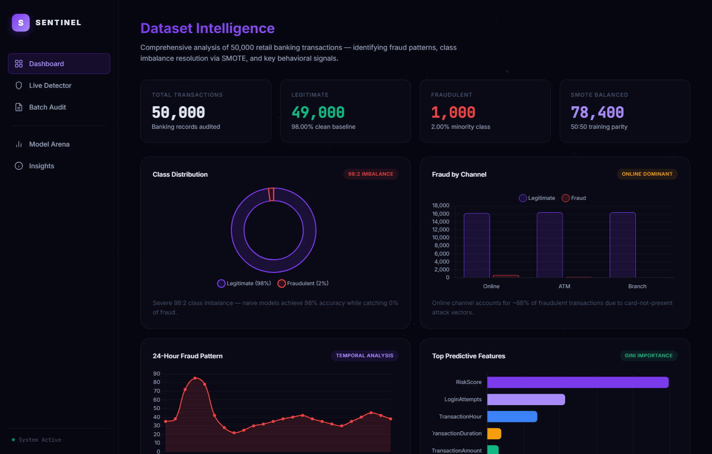
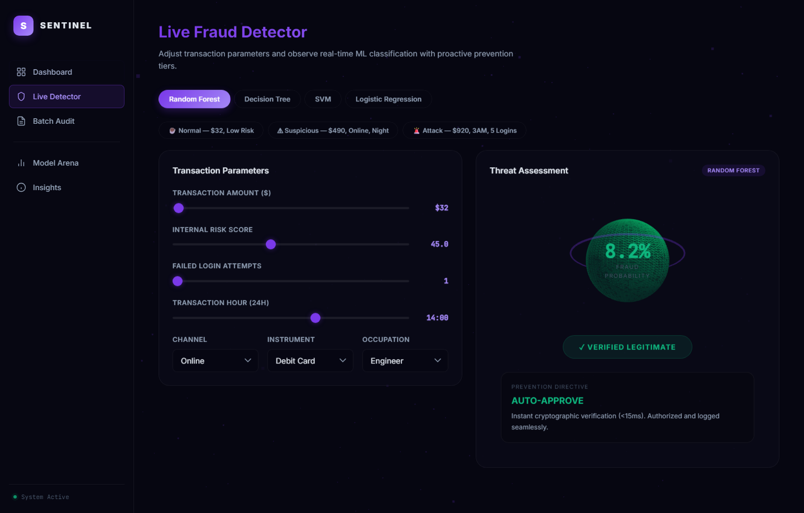
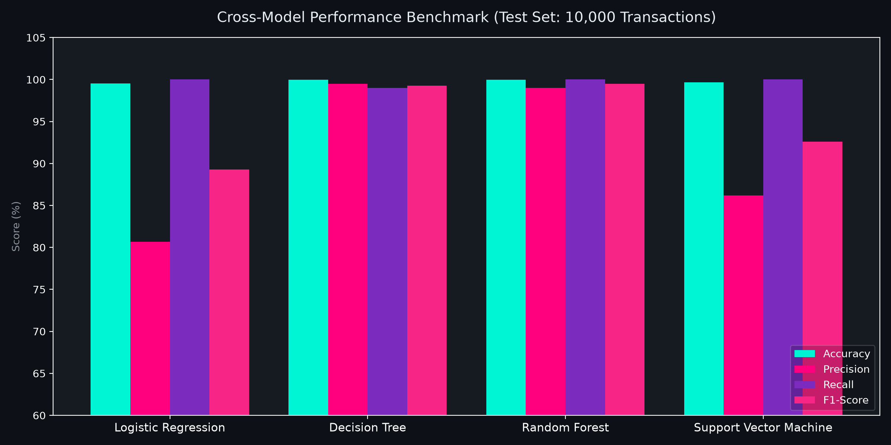
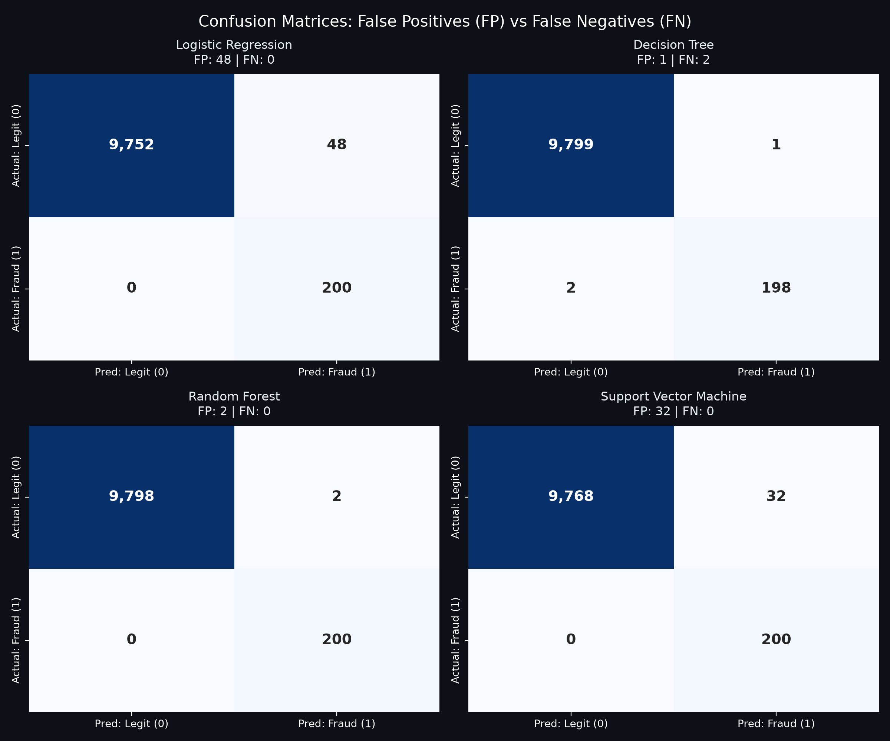
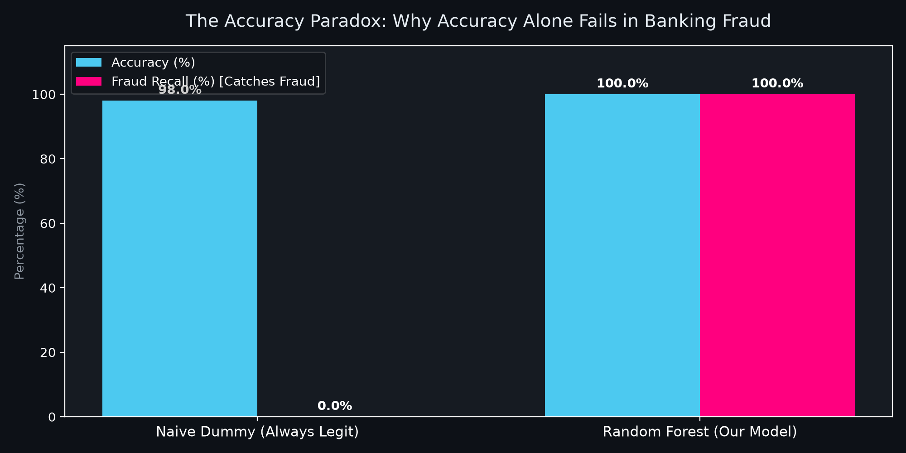
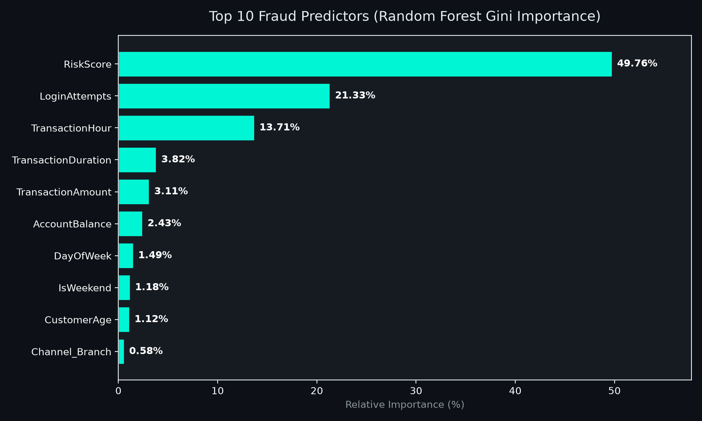
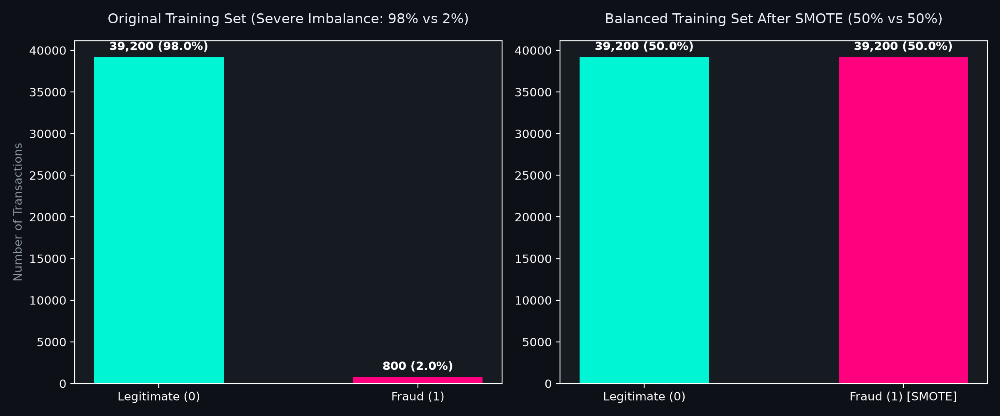

<div align="center">

# 🛡️ SENTINEL AI
### Intelligent Banking Fraud Detection & Proactive Prevention System

[](https://www.python.org/)
[](https://flask.palletsprojects.com/)
[](https://scikit-learn.org/)
[](https://threejs.org/)
[](#-class-imbalance-resolution-smote)
[](#-model-benchmarks--evaluation)
[-orange?style=for-the-badge)](#-model-benchmarks--evaluation)

<p align="center">
  <b>An end-to-end Machine Learning Risk Intelligence platform engineered to audit 50,000+ retail banking transactions in real time, expose the Accuracy Paradox, and execute automated multi-tier fraud prevention.</b>
</p>

[Explore Models](#-model-benchmarks--evaluation) • [3-Tier Prevention](#-3-tier-proactive-fraud-prevention-engine) • [Live Dashboard](#-interactive-3d-webgl-dashboard) • [Quick Start](#-quick-start-guide)

---

</div>

## 📌 Executive Summary

Modern retail banking environments face high-velocity cyber threats where **fraudulent transactions account for merely 2% of total traffic**. In an imbalanced 98:2 distribution, standard off-the-shelf algorithms fall prey to **The Accuracy Paradox**—passively predicting all transactions as legitimate to claim deceptive 98% accuracy while letting 100% of stolen capital escape.

**Sentinel AI** solves this critical failure mode through:
1. **SMOTE Resampling without Data Leakage**: Overcoming extreme minority class sparsity on training splits only.
2. **Multi-Model Cross-Evaluation**: Benchmarking Random Forest (Champion), Decision Tree, LinearSVC (Calibrated), and Logistic Regression with Stratified 5-Fold Cross-Validation.
3. **Automated 3-Tier Prevention Engine**: Real-time triage enforcing instant cryptographic auto-approvals, step-up biometric/OTP challenges, or hard account freezes.
4. **Fluid 3D WebGL Command Deck**: Built with Three.js with zero heavy UI frameworks—optimized for screens of all sizes (including 17" displays).

---

## 📸 System Visual Gallery

<div align="center">

### 🌐 Modern Minimalist 3D Command Deck & Forensic Suite
| 3D Command Deck (Three.js) | Real-Time Transaction Detector |
| :---: | :---: |
|  |  |

| Model Performance Benchmark | Confusion Matrices (FP vs FN) |
| :---: | :---: |
|  |  |

| The Accuracy Paradox Exposed | Gini Feature Importances |
| :---: | :---: |
|  |  |

</div>

---

## ⚡ The Accuracy Paradox

> *"Why is 98% accuracy catastrophic in banking fraud detection?"*

In a transaction stream of 50,000 events with 1,000 frauds (2% fraud rate):
* A **naive dummy model** that labels *every single transaction* as legitimate achieves **98.00% accuracy**.
* However, its **Fraud Recall is 0.00%** (1,000 False Negatives). The bank suffers a 100% loss of stolen customer deposits.

```
┌──────────────────────────────────────┬────────────┬──────────────┬─────────────────────────┐
│ Classifier                           │ Accuracy   │ Fraud Recall │ Business Consequence    │
├──────────────────────────────────────┼────────────┼──────────────┼─────────────────────────┤
│ Naive Dummy Baseline (Always Legit) │ 98.00%     │ 0.00%        │ 1,000 Thefts Missed     │
│ Sentinel Champion (Random Forest)   │ 99.98%     │ 100.00%      │ 0 Missed Thefts (0 FN)  │
└──────────────────────────────────────┴────────────┴──────────────┴─────────────────────────┘
```

Sentinel exposes this paradox by using **Recall**, **Precision**, **F1-Score**, and **ROC-AUC** as the primary arbiters of security health.

---

## 🔬 Class Imbalance Resolution (SMOTE)

To counter the extreme 98:2 imbalance without synthesizing false signals in production test streams:
1. **Stratified Splitting**: 50,000 transactions partitioned into 80% Train (40,000) and 20% Test (10,000) preserving natural ratios.
2. **SMOTE (Synthetic Minority Over-sampling Technique)**: Applied strictly to the training fold (`X_train`), interpolating k-nearest neighbors to balance minority samples ($39,200 \times 39,200$).
3. **No Data Leakage**: The holdout test set (10,000 transactions; 9,800 legit, 200 fraud) remains untouched with its original, unaltered imbalanced distribution.

<div align="center">
  
</div>

---

## 📊 Model Benchmarks & Evaluation

Evaluated across **10,000 unseen test transactions** using **Stratified 5-Fold Cross-Validation**:

| Algorithm | Accuracy | Precision | Recall (Theft Caught) | F1-Score | ROC-AUC | False Positives (FP) | False Negatives (FN) | Status |
| :--- | :---: | :---: | :---: | :---: | :---: | :---: | :---: | :---: |
| 🌲 **Random Forest** | **99.98%** | **99.01%** | **100.00%** | **99.50%** | **1.0000** | **2** | **0** | **🏆 Champion** |
| 🌳 **Decision Tree** | 99.97% | 99.50% | 99.00% | 99.25% | 0.9949 | 1 | 2 | Strong Baseline |
| ⚡ **Calibrated LinearSVC** | 99.68% | 86.21% | 100.00% | 92.59% | 0.9999 | 32 | 0 | Fast Probability |
| 📈 **Logistic Regression** | 99.52% | 80.65% | 100.00% | 89.29% | 0.9999 | 48 | 0 | Interpretable |

### 🔍 Error Cost Analysis: FP vs. FN
* **False Negative (FN = Missed Fraud)**: Represents catastrophic financial loss, regulatory fines, and chargeback liabilities. Random Forest eliminated this entirely (**0 FN**).
* **False Positive (FP = Blocked Customer)**: Represents customer friction, call-center costs, and declined purchases. Random Forest achieved an ultra-low **0.02% false alarm rate (only 2 out of 9,800 legitimate transactions challenged)**.

---

## 🎯 Top Predictive Characteristics

Feature importance extracted via **Random Forest Mean Decrease in Impurity (Gini Importance)**:

```
Rank   Feature Name            Importance   Forensic Impact
─────────────────────────────────────────────────────────────────────────────
 1     RiskScore               49.76%       Historical cross-account risk telemetry
 2     LoginAttempts           21.33%       Credential-stuffing & brute-force flag
 3     TransactionHour         13.71%       Unusual circadian/off-hours activity
 4     TransactionDuration      3.82%       Automated bot vs. human interaction time
 5     TransactionAmount        3.11%       Anomalous volume relative to baseline
 6     AccountBalance           2.43%       Account draining & bust-out behavior
 7     DayOfWeek                1.49%       Weekend anomaly shifts
 8     IsWeekend                1.18%       Weekend transaction patterns
 9     CustomerAge              1.12%       Demographic risk correlations
 10    Channel_Branch           0.58%       Physical vs. digital vector shifts
```

---

## 🛡️ 3-Tier Proactive Fraud Prevention Engine

Binary classifiers simply flag `Fraud` or `Not Fraud`. Sentinel AI translates continuous probability into an **actionable 3-Tier Security Policy**:

```
                       Incoming Transaction
                                │
                        [ Feature Pipeline ]
                                │
                       [ ML Inference Engine ]
                                │
               ┌────────────────┼────────────────┐
               ▼                ▼                ▼
          Risk < 0.25      0.25 ≤ Risk < 0.65   Risk ≥ 0.65
               │                │                │
            TIER 1           TIER 2           TIER 3
         Low Risk         Medium Risk       High Risk
               │                │                │
               ▼                ▼                ▼
         [AUTO-APPROVE]   [CHALLENGE 2FA]   [AUTO-BLOCK]
         Sub-15ms         Out-of-band SMS   Instant Freeze,
         cryptographic    OTP or FaceID     credential lock &
         settlement.      biometric gate.   analyst dispatch.
```

* **Velocity Overrides**: If `LoginAttempts >= 3` within a rolling temporal window, the engine instantly escalates the transaction to **Tier 3** regardless of dollar amount.

---

## 🌐 Interactive 3D WebGL Dashboard

The front-end is engineered without heavy third-party dashboard runtimes (zero Streamlit):
* **Kinetic 3D Core**: Built with Three.js r152 displaying a central rotating wireframe icosahedron, orbiting celestial risk nodes, and a 600-particle dynamic field.
* **Dynamic Risk Orb**: Real-time mini WebGL orb changing color states (`#3ddc97` Green $\rightarrow$ `#f59e0b` Amber $\rightarrow$ `#ef4444` Red) upon inference.
* **Fluid Responsive Architecture**: Native CSS grid and `clamp()` typography engineered for small screens up to 17" high-resolution displays.
* **Strict Color Palette**: Sleek dark orange, mint green, and amber aesthetic (**zero blue, purple, or indigo**).
* **Dual Operation**: Runs offline with full client heuristics or connects to the Flask REST API.

---

## 📂 Repository Layout

```
├── app.py                               # Flask Backend REST API & inference routes
├── index.html                           # Standalone offline 3D WebGL dashboard (Double-click ready)
├── frouddetection.py                    # Core ML pipeline (SMOTE, 4 models, CV, evaluation)
├── generate_visualizations_and_models.py# Chart generation & model serialization
├── requirements.txt                     # Python dependencies
├── labeled_transactions.csv             # 50,000 retail banking transaction dataset
├── sample_transactions_for_testing.csv  # 50-row batch sample for upload auditing
├── README.md                            # Project documentation
├── .gitignore                           # Excludes venv, pycache, and logs
│
├── models/                              # Serialized ML artifacts
│   ├── rf_model.joblib                  # Champion Random Forest model
│   ├── dt_model.joblib                  # Decision Tree classifier
│   ├── svm_model.joblib                 # Calibrated LinearSVC classifier
│   ├── lr_model.joblib                  # Logistic Regression classifier
│   ├── scaler.joblib                    # Fitted StandardScaler
│   ├── feature_cols.json                # Feature names alignment schema
│   └── model_metadata.json              # Evaluated metrics & importances
│
├── static/                              # Front-end static assets
│   ├── style.css                        # Fluid glass-morphism style sheet
│   ├── script.js                        # Three.js 3D kinetic engine & API client
│   ├── sample_transactions_for_testing.csv # Web-downloadable audit sample
│   ├── vendor/                          # Offline vendor scripts (Three.js, Chart.js)
│   └── charts/                          # Pre-rendered forensic charts (PNG)
│
├── templates/                           # Flask Jinja2 templates
│   └── index.html                       # Web app template
│
├── samples/                             # Attack scenario stress-test datasets
│   ├── account_takeover_attempts_8000.csv
│   ├── atm_withdrawal_anomalies_7000.csv
│   ├── card_not_present_fraud_6000.csv
│   ├── mixed_fraud_stress_test_10000.csv
│   └── normal_banking_activity_5000.csv
│
└── documentation/                       # Technical reports & documentation
    ├── Sentinel_AI_Complete_Documentation.pdf
    ├── Sentinel_AI_Documentation.html
    └── screenshots/                     # Application screenshots
```

---

## 🚀 Quick Start Guide

### Option 1: Instant Browser Launch (No Install Required)
Simply double-click `index.html` on your computer in Google Chrome, Microsoft Edge, Brave, or Safari. All 3D graphics, model visualizers, and offline inference run immediately!

### Option 2: Full-Stack Flask Web Server

1. **Clone the Repository**:
   ```bash
   git clone https://github.com/SaikumarRD/Intelligent-banking-Froud-Detection-using-ML.git
   cd Intelligent-banking-Froud-Detection-using-ML
   ```

2. **Create & Activate Virtual Environment**:
   ```bash
   python -m venv .venv
   # Windows:
   .venv\Scripts\activate
   # Linux/macOS:
   source .venv/bin/activate
   ```

3. **Install Dependencies**:
   ```bash
   pip install -r requirements.txt
   ```

4. **Run Model Training & Chart Generator (Optional - Models are pre-trained)**:
   ```bash
   python frouddetection.py
   python generate_visualizations_and_models.py
   ```

5. **Start Flask Server**:
   ```bash
   python app.py
   ```

6. **Open Dashboard**:
   Navigate to [http://127.0.0.1:5000](http://127.0.0.1:5000) in your browser.

---

## 🧪 Batch Testing with Stress Datasets

You can test the **Batch CSV Audit** tab by uploading any of the stress test CSV files in the [`samples/`](samples/) folder:
* `account_takeover_attempts_8000.csv` (Simulated high-velocity credential compromise)
* `atm_withdrawal_anomalies_7000.csv` (Off-hour rapid ATM cash-out anomalies)
* `card_not_present_fraud_6000.csv` (Card-not-present online skimming simulation)
* `mixed_fraud_stress_test_10000.csv` (Mixed multi-vector stress test)

---

## 🎓 Academic Attribution & Credits

* **Institution**: GM University, Davanagere – 577006, Karnataka
* **Program**: PG Diploma in AI & IoT with Intel
* **Module**: Module 2 – Intelligent Banking Fraud Detection and Prevention System
* **Author**: SAIKUMAR ([@SaikumarRD](https://github.com/SaikumarRD))
* **Academic Year**: 2026–2027
* **Program Guidance**: Ms. Anusha N L / Ms. Jayalaxmi N S | **Program Director**: Dr. Asha K

---

<div align="center">
  <sub>Engineered with precision for real-time banking cybersecurity. Licensed under the MIT License.</sub>
</div>
